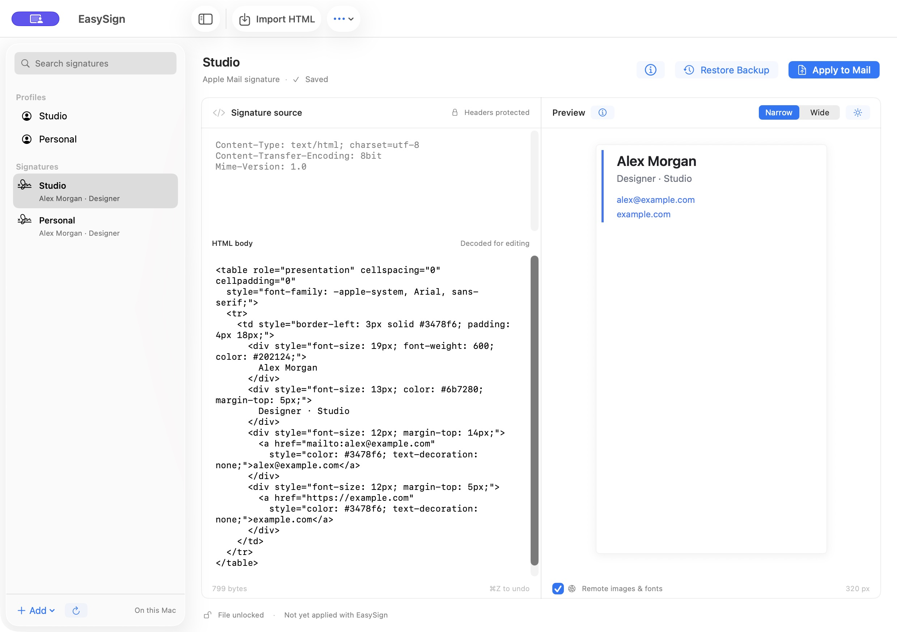

# EasySign

### A little more control over Apple Mail.

Custom HTML signatures and sender profiles, in a native macOS app.

[Get started](#get-started) · [User guide](docs/GUIDE.md) · [Releases](https://github.com/kavostudio/easysign/releases)

 

Native SwiftUI · macOS 14+ · Local by design

 

## Your signature, your HTML

Paste or import HTML, preview it, and apply it to an existing Mail signature. Keep your styles, tables, links, and images intact.

- **Edit with confidence.** Mail’s headers stay protected. Every apply gets a verified backup, with restore built in.
- **Preview as you work.** Narrow and wide layouts, light and dark backgrounds, and a remote-content toggle.
- **Keep profiles close.** Start a message or reply from the menu bar, then compose and send in Mail.
- **Stay in control.** No account, subscription, or analytics. Optional updates through Sparkle.

## Get started

**[Download EasySign 0.1.1 for Mac](https://github.com/kavostudio/easysign/releases/download/v0.1.1/EasySign-0.1.1.dmg)**

Open the signed, notarized DMG and drag EasySign into Applications. This is a preview release for macOS 14 or later, with Apple silicon and Intel support.

To build from source:

1. Open `EasySign.xcodeproj` in Xcode and resolve the Sparkle package.
2. Select your signing team and an Apple Development or Developer ID certificate.
3. Choose **EasySign → My Mac**, then press **⌘R**.

Create and assign your signature in Apple Mail first. In EasySign, select its folder, edit the HTML, and quit Mail before choosing **Apply to Mail**. Reopen Mail to check the result.

## Private by default

Signatures, profiles, and backups stay on your Mac. Folder access is requested through the macOS picker; profile actions request permission to control Mail. Full Disk Access is only a fallback if folder access fails.

Remote preview content and update checks can contact external servers. Neither uploads your signatures or profiles. Automatic update checks start off.

Backups live in `~/Library/Application Support/EasySign/Backups/`. Use **Restore Backup** while Mail is closed. [Permissions and recovery →](docs/GUIDE.md#backups-and-recovery)

## Good to know

EasySign is still in development. Preview rendering is approximate, and iCloud sync or Mail updates can affect installed signatures. Sender profiles have a reported name inconsistency; verify the received From header before relying on them.

Tested on Apple silicon with macOS 26.5.2 and Mail 16.0. Intel and macOS 14 runtime testing are pending.

---

[Build, use & recovery](docs/GUIDE.md) · [Release process](DISTRIBUTION.md) · [Report an issue](https://github.com/kavostudio/easysign/issues)

Licensed under the [GNU AGPL v3.0](LICENSE). Third-party components retain their [respective licenses](Resources/Sparkle-LICENSE.txt).
